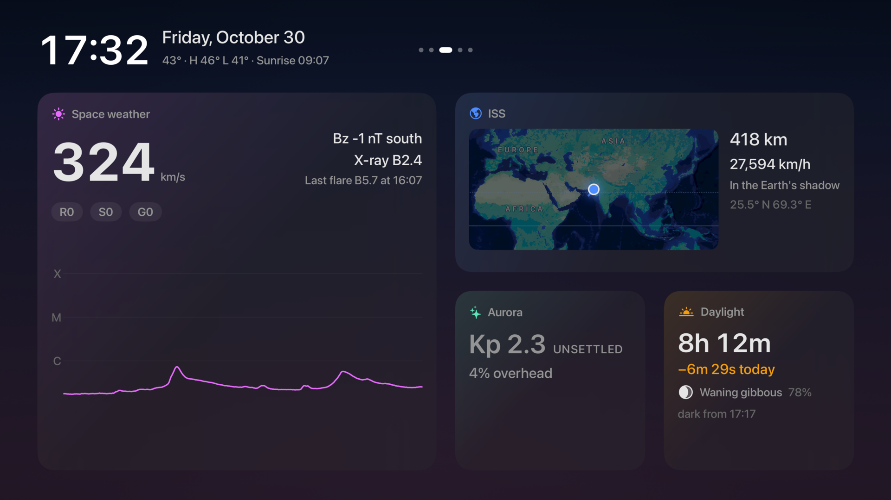
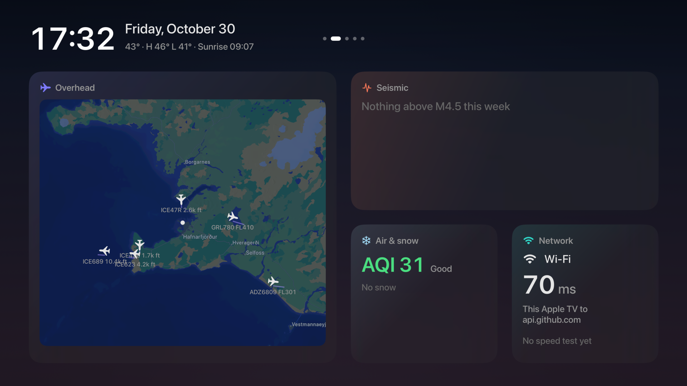

# Northlight

A widget dashboard for Apple TV, arranged from the Siri Remote or from a Mac menu bar app.



- Up to six pages of widgets, swiped like home screens on an iPhone
- Weather, forecast, air quality, aurora, daylight and earthquakes for your place
- Aircraft overhead on a live map
- Space weather, the ISS and upcoming rocket launches
- GitHub activity, pull requests and Actions, plus your coding agents' status
- Network latency and speed tests
- No backend: the TV calls public APIs directly, and the Mac talks only to the TV over an encrypted local connection



## Requirements

- Apple TV on tvOS 26 and a Mac on macOS 26
- Xcode 27.1 and [XcodeGen](https://github.com/yonaskolb/XcodeGen)

## Build

```sh
git clone https://github.com/ark-232/northlight && cd northlight
brew install xcodegen
xcodegen generate --spec App/project.yml
open App/Northlight.xcodeproj
```

Set `DEVELOPMENT_TEAM` and the bundle prefix in `App/project.yml` to your own, then run the `Northlight` scheme on your Apple TV and `NorthlightMac` on your Mac.

Run the tests with `swift test`.

## Data

Weather and air quality from [Open-Meteo](https://open-meteo.com/) (CC BY 4.0). Aircraft from [adsb.fi](https://adsb.fi/) (personal, non-commercial use). Every source is credited in the app's About screen.

## License

FSL-1.1-ALv2 (converts to Apache 2.0 after two years). See [LICENSE.md](LICENSE.md).
